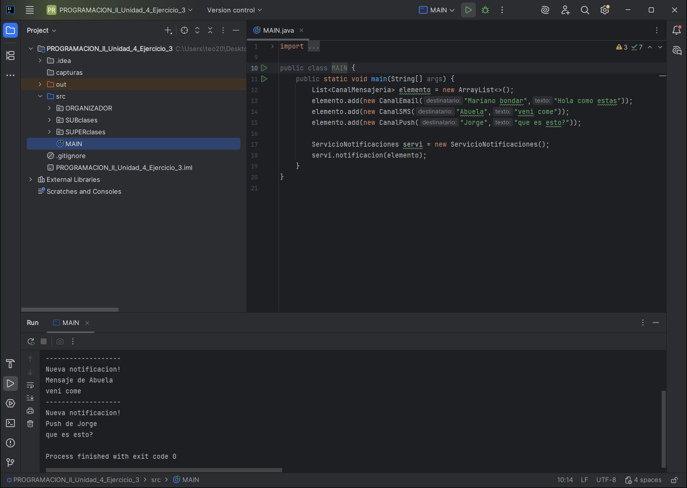

# PROGRAMACIÓN II — Unidad 4, Ejercicio 3: El Sistema de Notificaciones Omnicanal con Envío Polimórfico

Trabajo práctico de Programación II. Este repositorio contiene la resolución en Java del ejercicio 3 de la Unidad 4.

## Consigna

#### Contexto

Las aplicaciones corporativas emiten alertas masivas hacia sus usuarios mediante diversos canales de comunicación (correo electrónico, mensajes SMS y notificaciones push móviles). Para simplificar la arquitectura del sistema emisor, la plataforma despacha los avisos utilizando una referencia abstracta, delegando el protocolo de envío específico a cada canal.

#### Consigna

Construir una solución orientada a objetos en Java que aplique polimorfismo para enviar notificaciones a través de diferentes medios de comunicación de manera transparente.

#### Desarrollo requerido

- Crear una clase abstracta o interfaz CanalMensajeria con el método abstracto enviarMensaje(String destinatario, String texto).
- Implementar clases concretas como CanalEmail, CanalSMS y CanalPush que sobrescriban el método simulando la conexión con el servidor de cada proveedor.
- Diseñar una clase ServicioNotificaciones que reciba objetos de tipo CanalMensajeria para despachar alertas sin acoplarse a tecnologías específicas.
- En el método main, instanciar diferentes canales, aplicar polimorfismo pasando distintas instancias al servicio de envío y mostrar las trazas de comunicación por consola.

## Estructura del repositorio

```
PROGRAMACION_II_Unidad_4_Ejercicio_3/
├── README.md
├── capturas/
│   └── consola.png
└── src/
    ├── ORGANIZADOR/
    │   └── ServicioNotificaciones.java
    ├── SUBclases/
    │   ├── CanalEmail.java
    │   ├── CanalPush.java
    │   └── CanalSMS.java
    ├── SUPERclases/
    │   └── CanalMensajeria.java
    └── MAIN.java   # clase con el método main
```

## Funcionamiento y lógica

El ejercicio aplica **polimorfismo** para enviar notificaciones por distintos canales. Está organizado en los paquetes `SUPERclases`, `SUBclases` y `ORGANIZADOR`.

### `SUPERclases.CanalMensajeria` (clase abstracta)

Tiene `destinatario` y `texto` (privados, con getters) y el método abstracto `String enviarMensaje()`, que devuelve el mensaje armado.

### `SUBclases`

Cada canal arma el mensaje con su propio formato:

- **`CanalEmail`:** "Email", el destinatario con `@` y el texto.
- **`CanalSMS`:** "Mensaje de" + destinatario y el texto.
- **`CanalPush`:** "Push de" + destinatario y el texto.

### `ORGANIZADOR.ServicioNotificaciones`

Su método `notificacion(List<CanalMensajeria>)` recorre la lista y, para cada canal, anuncia "Nueva notificacion!" e imprime el mensaje que devuelve `enviarMensaje()`.

### `MAIN`

Crea una lista con un email para Mariano Bondar, un SMS de la Abuela y un push de Jorge, y el servicio muestra las tres notificaciones, cada una con el formato de su canal.

## Ejecución

Captura de la consola de IntelliJ IDEA ejecutando el programa:



Salida obtenida:

```
-------------------
Nueva notificacion!
Email
Destinatario:@Mariano bondar
Hola como estas
-------------------
Nueva notificacion!
Mensaje de Abuela
veni come
-------------------
Nueva notificacion!
Push de Jorge
que es esto?
```
